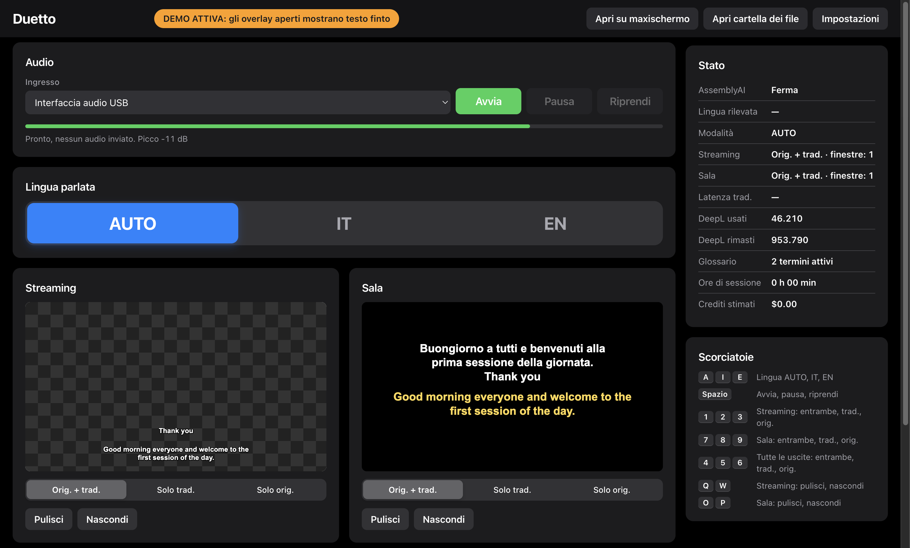

# Duetto

[English](README.md) · **Italiano**

**Sottotitoli in diretta, in italiano e in inglese, per eventi, conferenze e dirette streaming.**

[](https://ko-fi.com/E1X62AXF4L)

Duetto ascolta chi parla, trascrive in tempo reale e traduce ogni frase nell'altra lingua. I sottotitoli compaiono in due posti insieme, ognuno con il suo aspetto: sopra la diretta in OBS Studio e sul maxischermo in sala.

Niente stenotipisti, niente cabina per gli interpreti, niente codice: basta un portatile e il segnale audio del mixer.



## In breve

- **Italiano ↔ inglese, in tutte e due le direzioni.** La lingua viene riconosciuta frase per frase, anche quando chi parla cambia senza preavviso.
- **Due uscite indipendenti.** Una trasparente per OBS e una ad alto contrasto per il maxischermo, ognuna con il suo stile e i suoi comandi.
- **Stile tutto personalizzabile.** Caratteri, dimensioni, colori, contorno, sfondo e posizione, separati per originale e traduzione, salvabili come preset.
- **Fatto per reggere ore di diretta.** Se cade la rete si ricollega da solo senza perdere parole, e il pubblico non vede mai un errore.
- **File dei sottotitoli inclusi.** File SRT in ogni lingua e la trascrizione completa, scritti di continuo durante l'evento.
- **Si guida dalla tastiera.** Avvio, pausa, lingua e uscite hanno ognuno un tasto.

| Streaming (trasparente sul video) | Maxischermo in sala |
|---|---|
|  |  |

## Come funziona

Duetto funziona su **Mac** e su PC **Windows**. La trascrizione usa [AssemblyAI](https://www.assemblyai.com) e la traduzione [DeepL](https://www.deepl.com/pro-api): serve una chiave per ciascuno, ed entrambi offrono credito gratuito per iniziare. Un'ora di parlato costa all'incirca uno o due euro.

Scaricalo dalla pagina [Releases](https://github.com/Samuel782/Duetto/releases), aprilo e incolla le due chiavi. L'interfaccia è in italiano o in inglese, secondo la lingua del computer o la scelta nelle Impostazioni. All'avvio Duetto ti avvisa se c'è una nuova versione.

Le chiavi restano sul tuo computer, cifrate con il portachiavi del sistema, e così i file dei sottotitoli. Mentre Duetto è in funzione, l'audio va ad AssemblyAI e il testo a DeepL: avvisa relatori e partecipanti se l'evento lo richiede. Se i dati devono restare in Europa, scegli **Solo Unione Europea** nelle Impostazioni: AssemblyAI elaborerà l'audio sui suoi server europei.

## Gratis per te, a pagamento per lavoro

Duetto è **gratuito per uso non commerciale**: progetti personali, studio, scuole, associazioni senza scopo di lucro ed enti pubblici. Il codice è pubblico: puoi leggerlo, provarlo e modificarlo.

L'uso commerciale non è gratuito, ed è così che il progetto si sostiene:

- **Sottotitoli come servizio.** Porto io Duetto ai tuoi eventi, dall'allestimento ai file finali.
- **Licenze commerciali.** Agenzie, service audio-video e aziende che vogliono usare Duetto per il proprio lavoro possono avere una licenza su misura.
- **Donazioni.** Se Duetto ti è utile, un [caffè su Ko-fi](https://ko-fi.com/E1X62AXF4L) aiuta a portarlo avanti.

**Vuoi usare Duetto per lavoro? [Contattami](https://github.com/Samuel782/Duetto/issues) e ne parliamo.**

## Per sviluppatori

Serve [Node.js](https://nodejs.org) 20 o successivo.

```bash
npm install
```

```bash
npm run app
```

`npm test` esegue i test automatici con servizi finti, senza rete né credito. `npm run dist` crea i pacchetti per Mac e Windows nella cartella `dist/`.

```text
electron/   finestre, permessi, chiusura sicura
server/     trascrizione, traduzione, gestione delle frasi, file dei sottotitoli
public/     regia, impostazioni, uscite e cattura audio
test/       test automatici e servizi finti
```

## Licenza

[PolyForm Noncommercial 1.0.0](LICENSE). Le versioni fino alla 1.1.0 sono state distribuite con licenza MIT e restano tali. AssemblyAI e DeepL sono servizi di terze parti con i propri termini e costi.
