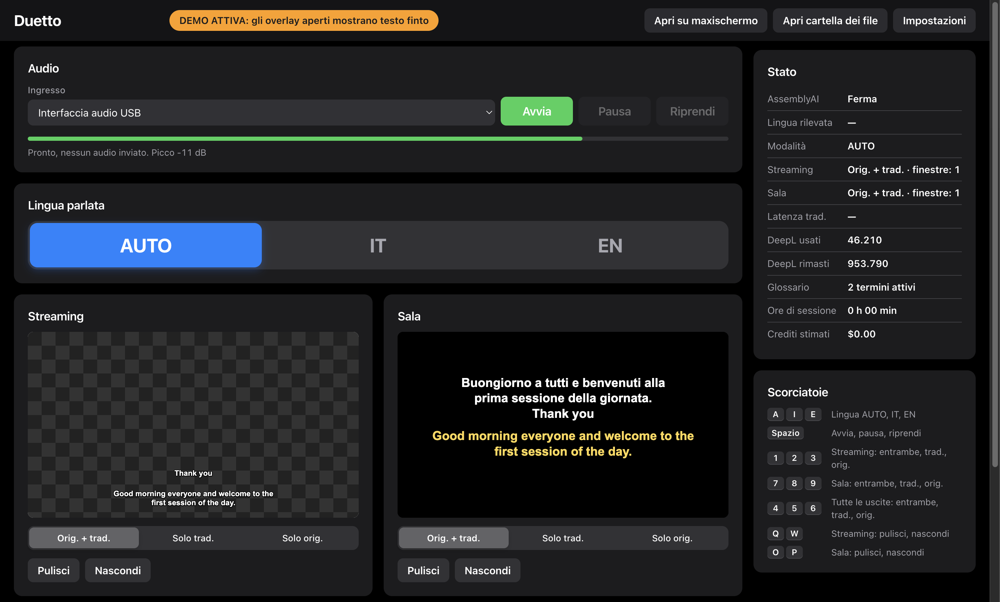
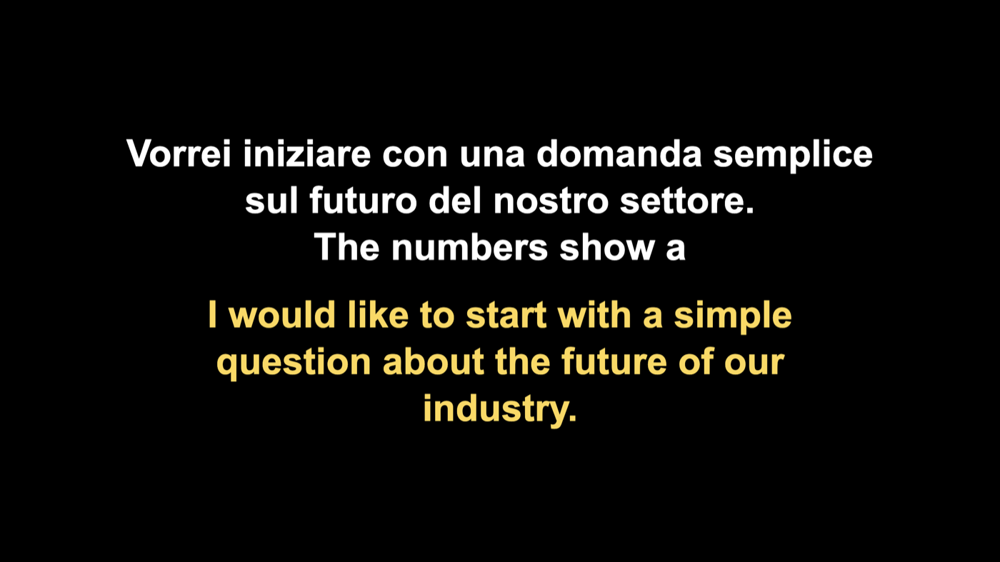

# Duetto

**English** · [Italiano](README.it.md)

**Live Italian and English subtitles for events, conferences and live streams.**

[](https://ko-fi.com/E1X62AXF4L)

Duetto listens to whoever is speaking, transcribes in real time and translates every sentence into the other language. Subtitles appear in two places at once, each with its own look: over the live stream in OBS Studio and on the big screen in the venue.

No stenographer, no interpreters' booth, no code: one laptop and an audio feed from the mixer.



## Highlights

- **Italian ↔ English, both ways.** The language is detected sentence by sentence, even when speakers switch without warning.
- **Two independent outputs.** A transparent overlay for OBS and a high-contrast view for the big screen, each with its own style and controls.
- **Full control of the style.** Fonts, sizes, colours, outline, background and position, separately for the original and the translation, saved as presets.
- **Built for hours on air.** It reconnects by itself if the network drops, without losing words, and the audience never sees an error.
- **Subtitle files included.** SRT files in each language and a full transcript, written continuously during the event.
- **Driven from the keyboard.** Start, pause, language and outputs each have a single-key shortcut.

| Streaming (transparent over video) | Big screen in the venue |
|---|---|
|  |  |

## How it works

Duetto runs on a **Mac** or a **Windows** PC. Transcription runs on [AssemblyAI](https://www.assemblyai.com) and translation on [DeepL](https://www.deepl.com/pro-api): you need a key for each, and both offer free credit to start. An hour of speech costs roughly one or two euros.

Download it from the [Releases](https://github.com/Samuel782/Duetto/releases) page, open it and paste the two keys. The interface is in English or Italian, following your computer's language or your choice in Settings. At startup Duetto tells you when a new version is available.

The keys stay on your computer, encrypted with the system keychain, and so do the subtitle files. While Duetto is running, audio is sent to AssemblyAI and text to DeepL: let speakers and attendees know if the event requires it. If data must stay in Europe, choose **European Union only** in Settings and AssemblyAI will process the audio on its EU servers.

## Free for you, paid for work

Duetto is **free for noncommercial use**: personal projects, study, schools, nonprofits and public bodies. The code is public, so you can read it, try it and change it.

Commercial use is not free. That's how the project pays for itself:

- **Subtitles as a service.** I run Duetto at events myself, from setup to the files at the end.
- **Commercial licences.** Agencies, AV companies and businesses that want to use Duetto for their own work can get a licence tailored to them.
- **Donations.** If Duetto is useful to you, a [coffee on Ko-fi](https://ko-fi.com/E1X62AXF4L) helps keep it going.

**Want to use Duetto for work? [Get in touch](https://github.com/Samuel782/Duetto/issues) and let's talk.**

## For developers

You need [Node.js](https://nodejs.org) 20 or later.

```bash
npm install
```

```bash
npm run app
```

`npm test` runs the automated tests with fake services, with no network or credit needed. `npm run dist` builds the packages for Mac and Windows into `dist/`.

```text
electron/   windows, permissions, safe shutdown
server/     transcription, translation, sentence processing, subtitle files
public/     control room, settings, outputs and audio capture
test/       automated tests and fake services
```

## Licence

[PolyForm Noncommercial 1.0.0](LICENSE). Version 1.1.0 and earlier were released under the MIT licence and remain so. AssemblyAI and DeepL are third-party services with their own terms and costs.
