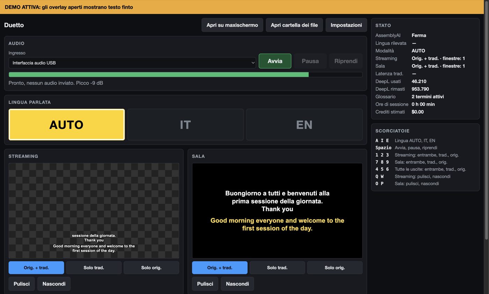
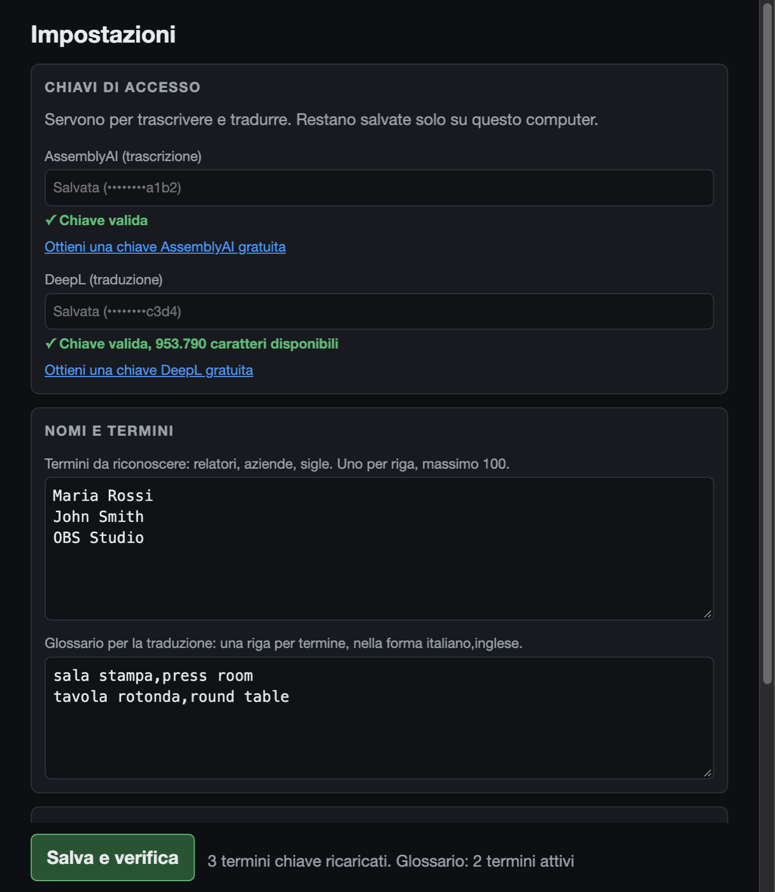
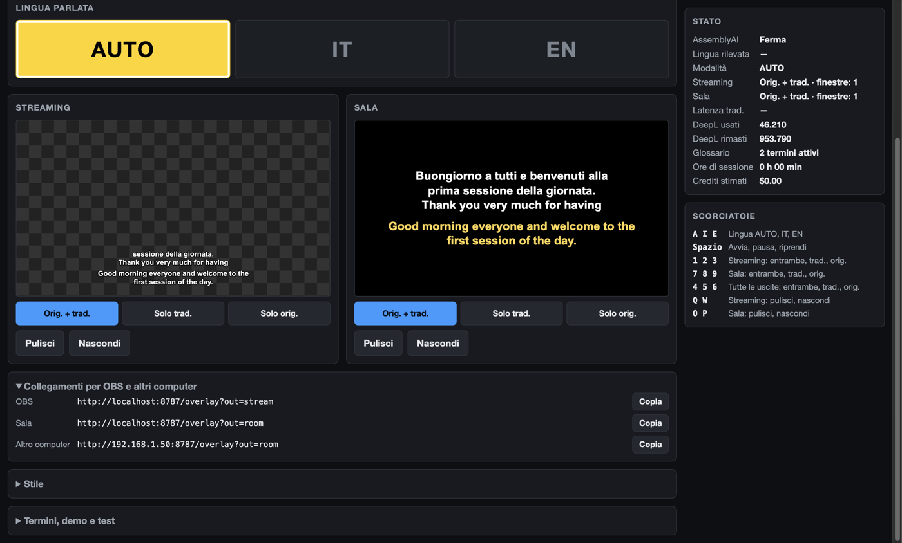
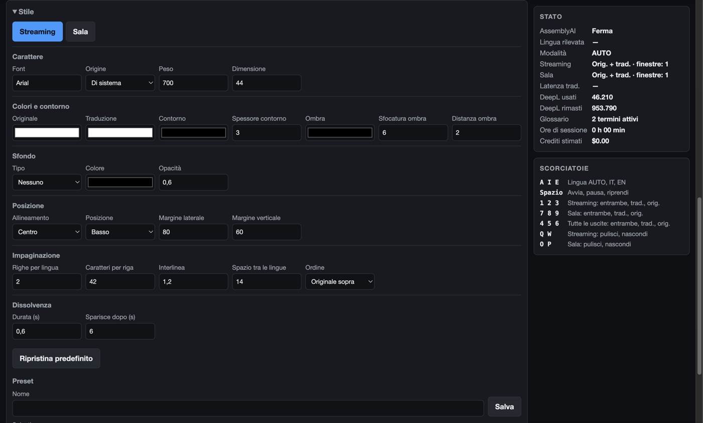

# Duetto

**Due lingue, due schermi, una sola regia: sottotitoli in diretta, in italiano e in inglese, per eventi, conferenze e dirette streaming.**

Chi parla viene trascritto mentre parla e ogni frase viene tradotta nell'altra lingua. I sottotitoli compaiono in due posti, ognuno con il proprio aspetto: sulla diretta in OBS Studio e sul maxischermo in sala.

Non serve un trascrittore e non serve saper programmare: durante l'evento basta qualche tasto.



## Cosa serve

- Un computer **Mac** (macOS 13 o successivo) oppure **Windows** 10 o 11 a 64 bit
- Una connessione a Internet: trascrizione e traduzione avvengono in cloud
- L'audio di chi parla, per esempio un'uscita del mixer collegata con un'interfaccia audio USB
- Due chiavi gratuite, spiegate più avanti: si ottengono in pochi minuti
- OBS Studio, solo se fai una diretta streaming

## Installazione

### Mac

1. Scarica il file giusto per il tuo Mac. Se non sai quale, apri  → *Informazioni su questo Mac*.
   - Chip Apple (M1, M2, M3…): `Duetto-1.0.0-mac-arm64.dmg`
   - Processore Intel: `Duetto-1.0.0-mac-x64.dmg`
2. Apri il file e trascina **Duetto** nella cartella **Applicazioni**.
3. Apri l'app. macOS la blocca, perché non è firmata con un certificato Apple. Chiudi l'avviso.
4. Apri *Impostazioni di Sistema → Privacy e sicurezza*, scorri in basso e premi **Apri comunque**.
5. Quando l'app lo chiede, consenti l'uso del **microfono**.

Il blocco si presenta solo la prima volta.

### Windows

1. Scarica `Duetto-1.0.0-win-x64.zip`.
2. Fai clic destro sul file e scegli **Estrai tutto**. Non avviare l'app da dentro lo zip.
3. Nella cartella estratta, apri **Duetto.exe**.
4. Se compare "Windows ha protetto il PC", premi **Ulteriori informazioni**, poi **Esegui comunque**.
5. Se il firewall chiede un permesso, consenti l'accesso alle reti private. Serve solo per aprire i sottotitoli da un altro computer.

## Primo avvio: le due chiavi

Le chiavi sono i codici personali con cui l'app usa i servizi di trascrizione e di traduzione. Al primo avvio si apre da sola la finestra **Impostazioni**.



1. **AssemblyAI** (trascrizione): [crea un account](https://www.assemblyai.com/dashboard/signup) e copia la chiave dalla pagina iniziale.
2. **DeepL** (traduzione): [crea un account API](https://www.deepl.com/pro-api) e copia la chiave da *Account → API Keys*. Serve un account **API**: quello del normale traduttore DeepL non basta.
3. Incolla le due chiavi e premi **Salva e verifica**. Un segno verde conferma che ogni chiave funziona.

Nella stessa finestra puoi aggiungere:

- **Termini da riconoscere:** nomi dei relatori, aziende, sigle. Migliorano molto il riconoscimento dei nomi. Elenca solo nomi e sigle: le parole comuni non servono e troppi termini possono peggiorare il risultato.
- **Glossario:** traduzioni obbligate di termini specifici, per esempio `tavola rotonda,round table`.
- **Pulizia del testo:** toglie gli intercalari come "ehm" e attenua le parolacce.

### Quanto costa

| Servizio | Offerta gratuita | Oltre l'offerta gratuita |
|---|---|---|
| AssemblyAI | 50 $ di crediti iniziali, circa 110 ore | 0,45 $ all'ora di collegamento |
| DeepL | Fino a 1.000.000 di caratteri in totale, a seconda del piano | Piano a pagamento |

Un'ora di parlato continuo usa circa 54.000 caratteri DeepL. Prezzi e offerte possono cambiare: controlla i siti dei due servizi. La schermata di regia mostra i caratteri rimasti e una stima dei crediti usati.

## Usare l'app in un evento

1. **Scegli l'ingresso audio** e controlla che la barra verde si muova quando qualcuno parla. Finché non premi Avvia non si consuma nulla.
2. **Collega le uscite:** [OBS](#diretta-streaming-con-obs) e [maxischermo](#maxischermo-in-sala).
3. **Premi Avvia** (o la barra spaziatrice). I sottotitoli partono entro un paio di secondi.
4. **Nelle interruzioni premi Pausa** (ancora la barra spaziatrice): non si consumano crediti.
5. **A fine evento chiudi l'app** e recupera i file con **Apri cartella dei file**.

## Le funzioni

### Lingua: AUTO, IT, EN

Tre grandi pulsanti scelgono la lingua parlata. Quello attivo è giallo, così si vede anche da lontano.

- **AUTO** riconosce da solo la lingua, frase per frase. È la scelta giusta quasi sempre, anche quando le lingue si alternano senza preavviso.
- **IT** ed **EN** dicono all'app quale lingua si sta parlando e quindi in che direzione tradurre. Usali solo se ne sei certo: con la lingua sbagliata il testo si vede, ma resta senza traduzione.

Il cambio vale dalla frase successiva e il pubblico non si accorge di nulla.

### Due uscite indipendenti

Streaming e sala hanno ciascuna la propria anteprima e i propri comandi. Per ogni uscita puoi scegliere:

- **Orig. + trad.:** testo originale e traduzione insieme
- **Solo trad.:** solo la traduzione, che compare a frase completa
- **Solo orig.:** solo il testo originale, che compare mentre si parla
- **Pulisci:** svuota subito lo schermo
- **Nascondi:** toglie i sottotitoli finché non premi Mostra

### Diretta streaming con OBS

I sottotitoli arrivano a OBS con lo sfondo trasparente, sopra al video. Il riquadro a scacchi qui sotto rappresenta la trasparenza.


1. In **Collegamenti per OBS e altri computer** premi **Copia** sulla riga OBS.

   

2. In OBS aggiungi una fonte **Browser** e incolla l'indirizzo.
3. Imposta larghezza `1920` e altezza `1080`.
4. Disattiva **Spegni la sorgente quando non è visibile**.
5. Metti la fonte sopra il video.

### Maxischermo in sala

Sfondo nero, testo grande e traduzione in un altro colore, per leggere da lontano.


- **Dallo stesso computer:** collega il maxischermo e premi **Apri su maxischermo**. I sottotitoli vanno a schermo intero sul secondo schermo. Per chiuderli, clicca su quella finestra e premi `Esc`.
- **Da un altro computer sulla stessa rete:** copia la riga **Altro computer** e aprila in un browser a schermo intero.

### Stile su misura

Nel pannello **Stile** ogni uscita ha le proprie regolazioni, che si vedono subito senza ricaricare nulla: carattere, colori, contorno, ombra, sfondo, posizione, margini, numero di righe, lunghezza delle righe, dissolvenza.

Puoi salvare gli stili con un nome e passarli a un altro computer con **Esporta JSON** e **Importa JSON**. Per i Google Font scrivi il nome e scegli **Google Font** come origine: serve Internet.



### Prova senza spendere

In **Termini, demo e test** il pulsante **Avvia demo** mostra frasi finte su tutte le uscite, senza consumare crediti e senza scrivere file: è il modo giusto per regolare gli stili. Una striscia arancione ricorda che è attiva. Si ferma da sola appena parte l'audio vero, ma **controlla sempre che sia spenta prima di andare in diretta**.

### I file dei sottotitoli

Durante l'evento l'app scrive di continuo nella cartella **Documenti/Duetto**, così non si perde nulla nemmeno in caso di arresto improvviso. Ogni avvio dell'app ha la propria sottocartella:

| File | Contenuto |
|---|---|
| `originale.srt` | Ogni frase nella lingua in cui è stata detta |
| `italiano.srt` | Tutto in italiano |
| `inglese.srt` | Tutto in inglese |
| `trascrizione.txt` | Il testo completo con orari e lingua |

I file `.srt` si caricano su YouTube e nei programmi di montaggio. I tempi sono approssimati, con uno scarto fino a circa un secondo.

### Scorciatoie da tastiera

| Tasto | Azione |
|---|---|
| `Spazio` | Avvia, pausa, riprendi |
| `A` `I` `E` | Lingua AUTO, IT, EN |
| `1` `2` `3` | Streaming: originale + traduzione, solo traduzione, solo originale |
| `7` `8` `9` | Sala: originale + traduzione, solo traduzione, solo originale |
| `4` `5` `6` | Entrambe le uscite insieme |
| `Q` / `W` | Streaming: pulisci / nascondi o mostra |
| `O` / `P` | Sala: pulisci / nascondi o mostra |

Le scorciatoie non agiscono mentre scrivi in un campo: clicca altrove nella finestra per riattivarle.

### Pensata per reggere ore di diretta

- **Se cade la rete**, l'app si ricollega da sola e recupera gli ultimi secondi di audio. Il pubblico vede solo i sottotitoli sparire e tornare; l'avviso compare solo in regia.
- **Il limite di 3 ore** di ogni sessione di AssemblyAI viene superato da solo, a fine frase, senza perdere parole.
- **Se la traduzione non arriva**, resta visibile il testo originale.
- **Il computer non va in stop** finché l'app è aperta.
- **Chiudere per sbaglio è difficile:** l'app chiede conferma.

## Se qualcosa non va

| Problema | Cosa fare |
|---|---|
| La barra del livello non si muove | Controlla l'ingresso scelto e il mixer. Su Mac: *Impostazioni di Sistema → Privacy e sicurezza → Microfono*. Su Windows: *Impostazioni → Privacy e sicurezza → Microfono* |
| Avviso di saturazione in rosso | Il segnale è troppo forte: abbassalo dal mixer |
| "AssemblyAI rifiuta la connessione" | Apri **Impostazioni** e premi **Salva e verifica**: la chiave è errata o i crediti sono finiti |
| Si vede il testo ma non la traduzione | Controlla in **Stato** l'errore DeepL e i caratteri rimasti, e che la lingua non sia impostata male |
| I sottotitoli non appaiono in OBS | Ricontrolla l'indirizzo: se la porta è occupata può cambiare, quindi ricopialo dall'app. Poi aggiorna la fonte |
| Nomi trascritti male | Aggiungili ai **Termini da riconoscere** |
| Le prime parole sono sbagliate | È normale: si correggono da sole in circa un secondo |

Il registro degli errori è il file `app.log` nella cartella dei dati dell'app:

- **Mac:** `~/Library/Application Support/Duetto`
- **Windows:** `%APPDATA%\Duetto`

## Le prove prima dell'evento

**Il giorno prima**

- [ ] Chiavi verificate con il segno verde e caratteri DeepL sufficienti
- [ ] Nomi dei relatori e sigle aggiunti ai termini
- [ ] Stili regolati con la demo, in OBS e sul maxischermo
- [ ] Una prova vera di qualche minuto, con le stesse voci o microfoni se possibile
- [ ] Aggiornamenti automatici e notifiche del computer disattivati

**Il giorno dell'evento**

- [ ] Computer collegato alla corrente
- [ ] Ingresso audio giusto e barra del livello che si muove, senza avvisi rossi
- [ ] OBS e maxischermo collegati: in **Stato** ogni uscita conta almeno 2 finestre, compresa l'anteprima
- [ ] Demo spenta
- [ ] Prova microfono e controllo dei sottotitoli su entrambe le uscite

## Privacy

- L'audio viene inviato ad **AssemblyAI** e il testo a **DeepL** mentre l'app è in funzione. Avvisa relatori e organizzatori se l'evento lo richiede.
- Le chiavi restano solo sul tuo computer, in un file non cifrato nella cartella dei dati dell'app: non condividere quella cartella.
- I sottotitoli sono visibili a chiunque sulla stessa rete conosca l'indirizzo, ma la regia si apre solo dal computer su cui gira l'app.

## Per chi costruisce l'app

Serve [Node.js](https://nodejs.org) 20 o successivo.

```bash
npm install
```

```bash
npm run app
```

Il primo comando installa le dipendenze, il secondo avvia l'app senza impacchettarla.

Per creare i pacchetti nella cartella `dist/`:

```bash
npm run dist
```

| Comando | Risultato |
|---|---|
| `npm run dist:mac` | `.dmg` per Mac Apple e Intel |
| `npm run dist:win` | `.zip` per Windows, si costruisce anche da Mac |
| `npm run dist:win:installer` | Installatore e `.exe` portatile per Windows. Su un Mac Apple richiede Rosetta |
| `npm test` | Prove automatiche con servizi finti, senza rete né crediti |
| `npx electron scripts/screenshots.mjs` | Rifà gli screenshot di questa guida |

**Togliere gli avvisi di sicurezza.** Gli avvisi al primo avvio spariscono solo firmando l'app, cosa che ha un costo:

- **Mac:** serve un account Apple Developer. Togli `"identity": "-"` da `package.json` e segui la [guida alla firma di electron-builder](https://www.electron.build/code-signing).
- **Windows:** serve un certificato di firma del codice, con la stessa guida.

La versione da riga di comando resta disponibile: copia `.env.example` in `.env`, inserisci le chiavi e usa `npm start`.

```text
electron/main.js       finestre, permessi, chiusura sicura
server/index.js        pagine, comandi, elaborazione delle frasi
server/assemblyai.js   sessione, riconnessione, cambio di sessione senza perdite
server/deepl.js        traduzione, utilizzo, glossario
server/settings.js     chiavi e preferenze
server/store.js        stato salvato e schema degli stili
server/textclean.js    intercalari e parolacce
server/transcript.js   file SRT e TXT
public/                schermate dell'app e cattura audio
test/                  prove automatiche, finti servizi, invio di file audio
```

## Licenza

Distribuito con licenza [MIT](LICENSE). Usa AssemblyAI e DeepL, servizi di terze parti con i propri termini e costi.
